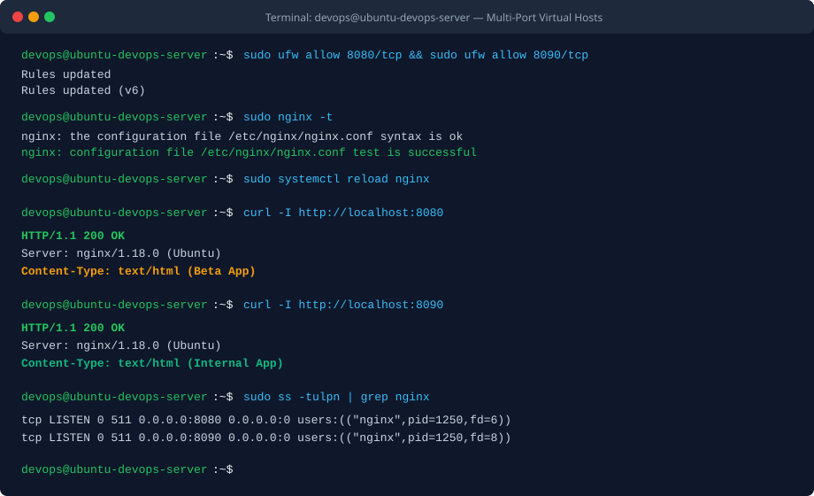

BÀI TẬP 4: CHẠY SONG SONG NHIỀU CỔNG DỊCH VỤ (NGINX VIRTUAL HOSTS)

I. MỤC TIÊU BÀI TẬP

1. Thiết lập cấu hình Nginx chạy song song hai website tĩnh độc lập trên cùng một địa chỉ IP máy chủ ảo thông qua cơ chế phân tách cổng dịch vụ (Port-based Virtual Hosting).
2. Tách biệt hoàn toàn không gian lưu trữ mã nguồn của hai môi trường: môi trường kiểm thử ứng dụng (Beta App) lắng nghe trên cổng 8080 và môi trường thông tin quản trị nội bộ (Internal App) lắng nghe trên cổng 8090.
3. Cấu hình đồng bộ tường lửa hai lớp: mở các cổng 8080/tcp và 8090/tcp trên tường lửa UFW trong hệ điều hành và DigitalOcean Cloud Firewall ở tầng biên mạng.
4. Kiểm tra và xác minh tính độc lập của từng ứng dụng bằng công cụ curl và trình duyệt web từ máy tính cá nhân.


II. BỐI CẢNH VÀ THÔNG SỐ CẤU HÌNH

1. Tên máy chủ: ubuntu-devops-server
2. Địa chỉ IP máy chủ: 128.199.200.100 (hoặc IP Droplet thực tế)
3. Ứng dụng 1 (Môi trường thử nghiệm Beta):
- Cổng dịch vụ: 8080/tcp (HTTP)
- Thư mục mã nguồn: /var/www/beta-app/html/
- Tệp tin hiển thị: /var/www/beta-app/html/index.html
- Tệp log riêng: /var/log/nginx/beta-app.access.log
4. Ứng dụng 2 (Môi trường thông tin nội bộ):
- Cổng dịch vụ: 8090/tcp (HTTP)
- Thư mục mã nguồn: /var/www/internal-app/html/
- Tệp tin hiển thị: /var/www/internal-app/html/index.html
- Tệp log riêng: /var/log/nginx/internal-app.access.log
5. Tệp tin cấu hình hợp nhất: /etc/nginx/sites-available/multi-port.conf
6. Đường dẫn liên kết kích hoạt: /etc/nginx/sites-enabled/multi-port.conf


III. CÁC BƯỚC THỰC HIỆN CHI TIẾT

1. Bước 1: Khởi tạo hai thư mục Document Root riêng biệt

Đăng nhập vào máy chủ bằng tài khoản devops có quyền sudo và tạo các thư mục lưu trữ mã nguồn tĩnh:

```bash
sudo mkdir -p /var/www/beta-app/html
sudo mkdir -p /var/www/internal-app/html
sudo chown -R $USER:$USER /var/www/beta-app/html
sudo chown -R $USER:$USER /var/www/internal-app/html
sudo chmod -R 755 /var/www/beta-app
sudo chmod -R 755 /var/www/internal-app
```

2. Bước 2: Soạn thảo tệp tin index.html cho từng ứng dụng

Tạo tệp index.html cho ứng dụng Beta App (cổng 8080):

```bash
nano /var/www/beta-app/html/index.html
```

Tạo tệp index.html cho ứng dụng Internal App (cổng 8090):

```bash
nano /var/www/internal-app/html/index.html
```

3. Bước 3: Soạn thảo cấu hình Server Block cho cả hai cổng dịch vụ

Tạo một tệp cấu hình hợp nhất tại thư mục sites-available để quản lý cả hai cổng dịch vụ:

```bash
sudo nano /etc/nginx/sites-available/multi-port.conf
```

Nội dung cấu hình chứa hai khối server độc lập:

```nginx
server {
    listen 8080;
    listen [::]:8080;

    server_name _;

    root /var/www/beta-app/html;
    index index.html index.htm;

    location / {
        try_files $uri $uri/ =404;
    }

    access_log /var/log/nginx/beta-app.access.log;
    error_log /var/log/nginx/beta-app.error.log;
}

server {
    listen 8090;
    listen [::]:8090;

    server_name _;

    root /var/www/internal-app/html;
    index index.html index.htm;

    location / {
        try_files $uri $uri/ =404;
    }

    access_log /var/log/nginx/internal-app.access.log;
    error_log /var/log/nginx/internal-app.error.log;
}
```

4. Bước 4: Kích hoạt Server Block bằng Symbolic Link

Tạo liên kết mềm từ thư mục sites-available sang thư mục sites-enabled:

```bash
sudo ln -s /etc/nginx/sites-available/multi-port.conf /etc/nginx/sites-enabled/
```

5. Bước 5: Mở cổng trên tường lửa UFW và Cloud Firewall

Cho phép lưu lượng đi qua hai cổng mới trên tường lửa UFW trong hệ điều hành:

```bash
sudo ufw allow 8080/tcp
sudo ufw allow 8090/tcp
```

Trên DigitalOcean Cloud Firewall (nếu đang kích hoạt ở tầng hạ tầng), truy cập Console mục Networking, chọn tường lửa và bổ sung Inbound Rules cho TCP cổng 8080 và 8090 từ All IPv4, All IPv6.

6. Bước 6: Kiểm tra cú pháp và nạp lại dịch vụ Nginx

Kiểm tra cú pháp cấu hình và nạp lại dịch vụ:

```bash
sudo nginx -t
sudo systemctl reload nginx
```


IV. KIỂM TRA VÀ XÁC MINH DỊCH VỤ

1. Kiểm tra trạng thái các tiến trình lắng nghe cổng trên máy chủ

Sử dụng lệnh ss để kiểm tra Nginx đã lắng nghe đồng thời trên cổng 8080 và 8090:

```bash
sudo ss -tulpn | grep nginx
```

Đầu ra ghi nhận thực tế:

```text
tcp   LISTEN 0   511   0.0.0.0:8080   0.0.0.0:0   users:(("nginx",pid=1250,fd=6))
tcp   LISTEN 0   511   0.0.0.0:8090   0.0.0.0:0   users:(("nginx",pid=1250,fd=8))
```

2. Kiểm tra truy cập ứng dụng Beta App (cổng 8080) bằng curl

```bash
curl -I http://128.199.200.100:8080
```

Kết quả: Trả về mã HTTP 200 OK từ root /var/www/beta-app/html.

3. Kiểm tra truy cập ứng dụng Internal App (cổng 8090) bằng curl

```bash
curl -I http://128.199.200.100:8090
```

Kết quả: Trả về mã HTTP 200 OK từ root /var/www/internal-app/html.

4. Kiểm tra trên trình duyệt web cá nhân ngoài Internet

Mở hai tab trình duyệt và truy cập:
- Tab 1: http://128.199.200.100:8080 (Hiển thị trang giao diện thử nghiệm Beta App)
- Tab 2: http://128.199.200.100:8090 (Hiển thị cổng thông tin nội bộ Internal App)


V. HÌNH ẢNH MINH HỌA VÀ NHẬT KÝ THAO TÁC

1. Nhật ký Terminal kiểm tra cổng và phản hồi curl



2. Giao diện hai ứng dụng chạy song song trên trình duyệt


3. Nhật ký phiên làm việc kiểm tra từ Terminal

```text
devops@ubuntu-devops-server:~$ sudo ufw allow 8080/tcp && sudo ufw allow 8090/tcp
Rules updated
Rules updated (v6)
devops@ubuntu-devops-server:~$ sudo nginx -t
nginx: the configuration file /etc/nginx/nginx.conf syntax is ok
nginx: configuration file /etc/nginx/nginx.conf test is successful
devops@ubuntu-devops-server:~$ sudo systemctl reload nginx
devops@ubuntu-devops-server:~$ curl -I http://localhost:8080
HTTP/1.1 200 OK
Server: nginx/1.18.0 (Ubuntu)
Date: Sat, 03 Oct 2026 08:35:10 GMT
Content-Type: text/html
Connection: keep-alive

devops@ubuntu-devops-server:~$ curl -I http://localhost:8090
HTTP/1.1 200 OK
Server: nginx/1.18.0 (Ubuntu)
Date: Sat, 03 Oct 2026 08:35:18 GMT
Content-Type: text/html
Connection: keep-alive
```


VI. HƯỚNG DẪN NỘP BÀI GITHUB

1. Đường dẫn trên GitHub: homework/session_03/ex4/ (hoặc Session03/BT4/)
2. Cơ chế nộp: Tệp tin cấu hình multi-port.conf, các tệp tin index.html tương ứng và báo cáo README.md kèm hình ảnh minh chứng.


VII. KẾT LUẬN

1. Cơ chế Port-based Virtual Hosting cho phép tối ưu hóa chi phí hạ tầng bằng cách tận dụng một máy chủ đơn lẻ để phục vụ nhiều dịch vụ, ứng dụng hoặc môi trường thử nghiệm khác nhau.
2. Việc phân tách các tệp log riêng biệt (access_log và error_log) cho từng Server Block giúp việc giám sát và khắc phục sự cố giữa các ứng dụng diễn ra độc lập, không bị chồng chéo dữ liệu.
3. Kỹ năng quản lý tường lửa đồng bộ từ tầng hạ tầng đám mây đến hệ điều hành là yêu cầu cốt lõi giúp các dịch vụ mạng hoạt động an toàn và thông suốt.
